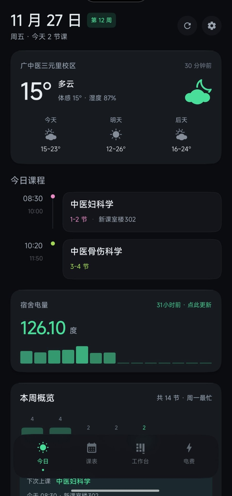
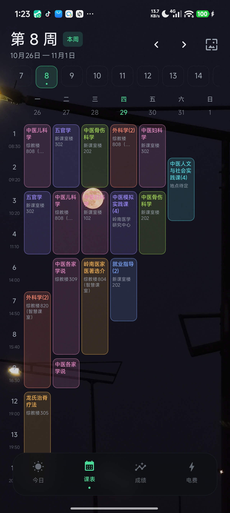
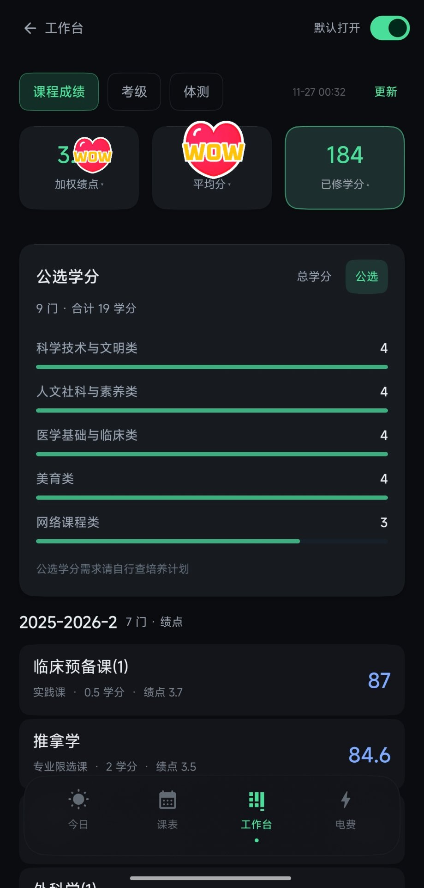
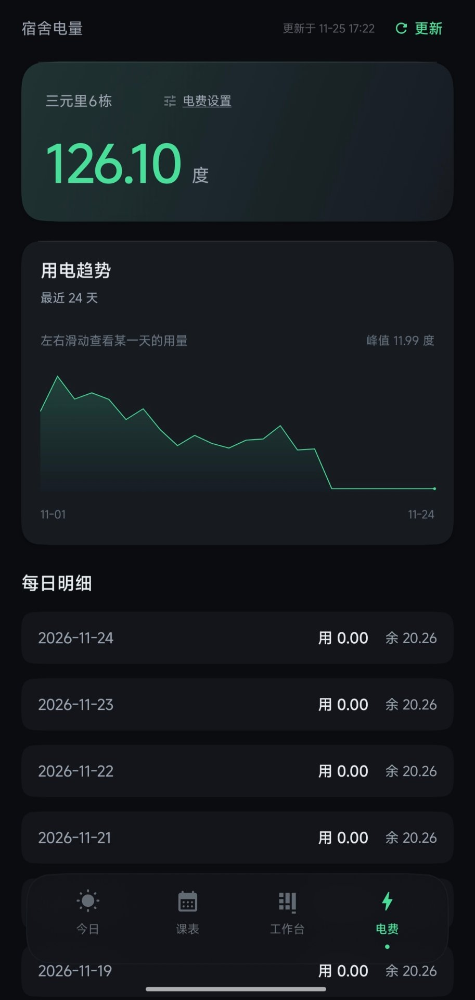

# 广中医口袋

广州中医药大学学生自用的 Android 客户端。课表、成绩、宿舍电费、自己加的日程和待办，收进一个 App，按你每天真正要看的顺序排。

> **非官方项目。** 与广州中医药大学无任何隶属关系，未获学校授权或认可。
> 数据直连学校系统，不经过任何第三方服务器。

## 它解决的是哪件事

学校的课表在教务系统里，得先登录、再点三层菜单、再按周翻；电费在一卡通页面，想知道还剩几天得自己看；成绩出来要等别人提醒。这些信息本身不难，难的是每天重复这几次。

这个 App 做的事很具体：打开就是**今天**——几节课、下一节在哪、这周还剩几天、宿舍的还能撑几天。要细看再往下点，课表能翻周、也能切成一天一列；成绩按学期排好，绩点和学分构成直接算完；电费每天第一次打开时后台静默更新一次。

## 功能

### 今日

一屏看完今天，不用点：

- 今天的课程时间轴，**正在上的那一节高亮**，上过的自动变淡
- 下一节课是什么、几点、在哪、谁上
- 本周每天几节课的分布，最忙的那天标出来
- 宿舍剩余电量、近 7 天日均、按这个速度还能用几天、最近两周的日用量柱状图
- 今天有哪些日程、有没有考试
- **天气**：现在多少度、体感、湿度，未来三天的高低温和天气（出门前扫一眼）
- **接下来**：未来几天还有哪些日程和考试，最多列五条；显示几天可以自己调（1~14 天）

今日页显示哪几块可以自己定（电费 / 天气 / 接下来 / 本周概览），在设置 → 今日页显示里改，长按今日页任意卡片也能直接打开。今日课程不参与开关 —— 那是这个页面存在的理由。关掉天气之后，App 也不会再在后台请求天气接口。

### 课表

**周视图**
- 课程块按**实际跨节数**渲染：占 7-9 节的课就是三行高，不是一律等高
- 同一时段有多门课时按卡片层叠，右下角 **⇄** 轮换看清是哪一条；点开是完整详情（教室、教师、课程号、第几周）
- 翻到别的周以后，右下角会出现**「回到今日」**，点一下回今天；今天那一格有淡描边，滑远了也知道今天在哪

**日视图**
- 一天一列卡片，左右滑换天；滑到周日接着进下一周，滑到周一往回是上周
- 卡片背后是**身后那片墙纸的磨砂**，不是半透明色块；三种状态分得开——上过的课最淡、还没上的次之、正在上的最实，都跟着「格子不透明度」滑块走（3%~100%）

**每节课都带「这次讲什么」**
- 按周抓取，不是笼统的学期总表：同一天两节中医各家学说，会分别写「王泰林」和「张锡纯」
- 带真实日期、授课教师、教室；教务没录教室的会显示「地点待定」

**背景**
- 从相册选图当背景，透明度可调；也可以整体模糊，或只让课程格子磨砂
- 背景太亮或太暗时，周数、星期、节数这些字会自动换深浅色

**日程、考试与待办**
- 长按某天的空白格就地新建，或从「我的日程」进；时间可以按节次（第几节到第几节）也可以按具体时间，切换时自动换算
- 日程直接画进周课表和日视图，和课程撞时段时用同样的层叠规则；只存在本机，同步课表、切换学段、退出登录都不会丢
- 考试排好后自动出现（红色虚线块），点开能看日期、时间、考场、座位、监考、校区、周次
- **截止任务**：只填一个 DDL，留空就是长期待办；首页点圆圈勾掉，逾期没做的标红置顶

**提醒**
- 上课提醒：课前 20 分钟；上一节还没下课时改成课间提前 10 分钟，通知里有课程名、地点、教师、这次讲什么
- 日程提醒：准时、提前 5 / 10 / 15 / 30 分钟、提前 1 小时、提前 1 天，**可以多选**，每个档位各响一次
- 两套提醒走各自的队列，关掉上课提醒不影响日程提醒；开机、改系统时间、每天兜底都会自动重排
- 系统省电策略总推迟通知时，可以打开「增强提醒方案」，按闹钟级别排（代价是状态栏多个闹钟图标）

**其它**
- **课表导出**：一串能直接粘进微信的分享串，或完整 json 文件（给做课表网页的工具用，不涉及账号密码）
- 断网时仍能看到上次同步的课表，会标明是离线缓存

### 成绩

- **课程成绩**：按学期倒序分组，顶部加权绩点、平均分、已修学分；点开「已修学分」能看学分构成，按美育类、科学技术与文明类等分类，每类按 4 学分画满
- **考级**：四六级等，总分、各单项、考试日期
- **体测**：总分、等级、每个项目的数值和得分
- 本科生、研究生两套系统都支持；研究生单独登录一次即可，和本科的数据分开存

### 电费

- 大号余额数字、近 7 天日均、预计还能用几天、近 30 天折线（带峰值标注）、每日明细
- **每天第一次打开 App 时后台静默更新**，不弹窗；想立刻看最新的可以手动刷新
- 余额不足 3 天时推一次提醒，每天最多一次
- 房间号跟着一卡通账号走，不用自己填；换宿舍会直接显示新宿舍号

### 用起来顺手的部分

- **平板**：左侧导航栏，四个页面左右分栏、各自独立滚动；课表显示教室和教师，重叠课程并排，可选灰色网格线
- **主题色**：12 种配色（10 个预设 + 默认 + 自定义取色），色卡两行排满
- **深色模式**：跟随系统，也能手动锁定
- **悬浮底栏**：课表页静置 3 秒会渐隐，摸一下先亮回来、再点才切页；其它三页永远全亮
- **更新**：App 内检查、下载、安装，不用去网页找安装包
- **问题反馈**：设置 → 问题反馈，面板上大字显示当前版本号（点一下复制），再点「打开问卷」去填，可以传截图和录屏

## 截图

| 今日 | 课表 |
|:---:|:---:|
|  |  |
| 当天课程、下次上课、本周概览、宿舍电量 | 按周课表，支持自定义背景 |

| 成绩 | 电费 |
|:---:|:---:|
|  |  |
| 加权绩点、学分构成、分级列表 | 余额、趋势、每日明细、手动更新 |

## 安装

到 [Releases](https://github.com/Hello-Minecraft/gzucm-pocket/releases/latest) 下最新的 APK 直接装（需要允许「安装未知来源应用」）。Android 8.0 及以上。

第一次打开要登录一次：可以走内嵌网页输学号密码，也可以微信扫码。登录状态会被保留，过期了会提示。

## 隐私

- 账号密码**只在学校的认证页面输入**，App 不接触、不保存、不上传
- 抓到的会话 Cookie 存在应用私有目录，退出登录即清空
- 无统计、无埋点、无广告、无第三方 SDK
- 网络请求只有三类：`jw.gzucm.edu.cn`（教务）、`ecard.gzucm.edu.cn`（一卡通）、GitHub（检查更新），再加上天气转发函数那一个地址
- **天气是唯一的第三方**：和风天气（qweather.com）。正常部署下 App 只请求**自己的转发函数**（只发城市编码，不带账号、设备或位置信息），由函数去问和风并缓存 30 分钟；不想要可以把首页的天气卡关掉，也可以直接用不带天气配置的构建版本

## 实现上有意思的地方

### 电费必须用 WebView

一卡通（`ecard.gzucm.edu.cn`）的会话存在于 WebView 的 Cookie 里，用 OkHttp 直接调接口拿不到有效会话。所以电费是这么做的：

1. 用不可见（1dp）的 WebView 加载电费页
2. 在页面里**劫持 `XMLHttpRequest`**，截获页面自己发出的请求
3. 把响应通过 `addJavascriptInterface` 回传给 Kotlin 解析

参数、token、cookie 全由页面自己生成，客户端不用猜签名规则。

余额读的是页面上服务端渲染好的那个数字，**不调 `getBalance`** —— 那个接口是给「查别人房间」用的，按自己的房间调会返回 `查询失败`。

### 课表按周查询

同一个接口 `POST /new/student/xsgrkb/getCalendarWeekDatas`，`zc`（周次）参数决定返回粒度：

| `zc` | 返回 | 差异 |
|---|---|---|
| 空 | 整学期，50 行 / 40 字段 | 有 `jxcdmc2`（逐周教室串），**没有上课内容** |
| 具体周次 | 该周，17 行 / 43 字段 | 多出 `sknrjj`（上课内容）、`qsrq`（真实日期） |

**行数完全一致**（同一周两边都是 17 条，逐条对得上），所以只要把 `zc` 换成周次，就能拿到更细的字段。实现上并发 5 个请求逐周拉取；全部失败时自动退回学期总表，至少还有课表可看。

### 界面

面板是自己画的连续曲率圆角（G3），阴影交给系统的 elevation 那一层，不叠渐变、不多加裁剪层。磨砂是**采样身后那片壁纸再模糊**（`BitmapShader` + 固定缩放平移），所以滑动时格子跟着壁纸走、不会被拉长。

## 构建

需要 JDK 17+ 和 Android SDK（compileSdk 35）。

```bash
git clone https://github.com/Hello-Minecraft/gzucm-pocket.git
cd gzucm-pocket
echo "sdk.dir=/path/to/Android/sdk" > local.properties
./gradlew assembleDebug
```

### 签名

仓库里**不含签名密钥**。构建时若根目录有 `keystore.properties` 就用它签名，没有则自动退回 debug 签名：

```properties
storeFile=app/your-key.jks
storePassword=****
keyAlias=****
keyPassword=****
```

### 天气（可选）

天气要一个自己的转发函数（和风 JWT 的私钥不能进 APK）。`weather.properties`（不进仓库）：

```properties
# 推荐：自己的云函数（见 serverless/qweather-proxy/）
base=https://xxxxx.cn-hangzhou.fcapp.run
app_token=和函数环境变量 APP_TOKEN 相同的串

# 或者直连（只有 API Key 模式走得通，JWT 不行）
# key=你的 API Key
# host=https://xxxxxxxx.re.qweatherapi.com
```

没有这个文件时 `BuildConfig.WEATHER_BASE` 和 `WEATHER_KEY` 都是空串，天气卡整块不渲染，其余功能完全正常。
函数怎么部署、为什么不让 App 直接拿 token，见 [`docs/WEATHER_PROXY.md`](docs/WEATHER_PROXY.md)。

## 测试

```bash
./gradlew testDebugUnitTest
```

560 多项单元测试与截图测试（Robolectric），覆盖：

| 测试 | 说明 |
|---|---|
| `WeeklyScheduleTest` | 按周课表解析，样本是真实响应脱敏后 |
| `EcardParseTest` | 电费解析（余额带单位、`dateTime` 字段、0 值陷阱） |
| `PowerAlertTest` | 电费提醒判定：何时该提醒、何时绝不能误报 |
| `AgendaReminderScheduleTest` | 提醒排程：档位、去重、跨天、跨周 |
| `TaskTest` / `AgendaTaskFormTest` | 截止任务的紧迫度、完成与撤销 |
| `TimetableExportTest` | 导出串的往返一致性与体积闸门（微信发得出去） |
| `FrostedBackdropTest` / `BackdropInkTest` | 磨砂变换不变量、文字墨色判定 |
| `G3ShapeTest` / `MicaPanelTest` | 圆角路径与云母面板的层次 |
| `ScreenshotTest` | 逐屏截图，深浅色、壁纸极端情况都在 |
| `ReleaseNotesTest` | 版本日志护卫：最新条目必须等于当前版本号 |

## 文档

调研记录、踩坑与实现内幕、发版说明都在 [`docs/`](docs/)，见 [docs/README.md](docs/README.md)。改代码前建议先读 [`docs/PITFALLS.md`](docs/PITFALLS.md)。

## 致谢

- `gzucm-probe/` 里的抓包脚本用于逆向接口字段（Playwright + CDP）。仓库里不含任何真实抓取数据（课表、房号、Cookie 均已排除）。
- 天气图标来自 [QWeather Icons](https://github.com/qwd/Icons)（MIT），见 [`docs/QWEATHER_ICONS.md`](docs/QWEATHER_ICONS.md)。

## 许可

[MIT](LICENSE)

## 免责

- 本项目仅供学习交流与个人使用
- 请遵守学校的信息系统使用规定，不要高频请求
- 因使用本软件产生的任何后果由使用者自行承担
- 若学校方面有异议，会立即停止维护并删除仓库

---

以上内容均由 AI 生成。
